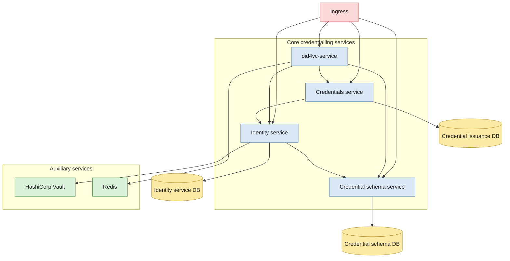

# High-Level Architecture

The microservices behind Sunbird RC credentialling, and how identity, schema, issuance and verification flows work.

Sunbird RC's credentialling service is made up of three microservices. Expand each to learn what it does.

Identity microservice

The central lynchpin for maintaining identities across the system. All identities in Sunbird RC are DID-compliant and web-resolvable. The other two microservices (Credential Schema and Credential Issuance) depend on it to generate any identity.

Credential Schema microservice

Stores the schema of each verifiable credential, along with its associated view template.

Credential Issuance microservice

The core issuance service. It takes a payload, transforms it into a W3C-compliant verifiable credential in JSON-LD format, and signs it using the private key generated when the issuer was created.

## High-level component diagram

<i class="rc-swatch ingress"></i>Entry point<i class="rc-swatch core"></i>Core credentialling services<i class="rc-swatch scale"></i>Auxiliary services<i class="rc-swatch db"></i>Databases

## How it works

:::: tabs
== Direct API flow

This sequence diagram explains the following flows:

* Creating an identity
* Creating a schema
* Issuing a credential
* Verifying a credential

<figure><figcaption></figcaption></figure>

== OID4VC / VP wallet flow

This sequence diagram explains the OID4VC/VP flow:

* Creating an identity
* Creating a schema
* Fetching issuer metadata (OID4VCI discovery)
* Issuing a credential (OID4VCI, wallet-initiated pre-authorized flow)
* Verifying a credential (OID4VP, DCQL-based presentation)

<figure><figcaption></figcaption></figure>
::::

