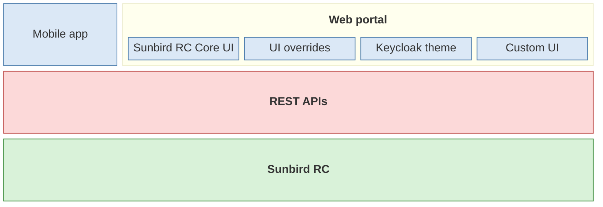

# Tech Stack and Requirements

Software versions needed to run Sunbird RC credentialling services.

## Architecture diagram

## Tech stack

<table><thead><tr><th width="284">Software / language</th><th>Recommended</th><th>Minimum version</th></tr></thead><tbody><tr><td>Node.js</td><td>20.20.2</td><td>20.11.0</td></tr><tr><td>Linux</td><td>24.04 LTS</td><td>22.04 LTS</td></tr><tr><td>Docker</td><td>29.8.1</td><td>25.0.0</td></tr><tr><td>PostgreSQL</td><td>18.6</td><td>14</td></tr><tr><td>nginx</td><td>1.30.4</td><td>1.30.0</td></tr><tr><td>Kubernetes</td><td>1.36.4</td><td>1.35.0</td></tr><tr><td>Helm</td><td>4.2.3</td><td>4.0.0</td></tr><tr><td>Docker Compose</td><td>5.5.1</td><td>2.0.0</td></tr></tbody></table>
