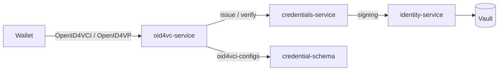

# OpenID for Verifiable Credentials (OID4VCI)

`oid4vc-service` is a protocol façade: it speaks OpenID4VCI 1.0 (issuance) and OpenID4VP 1.0/draft-23 (presentation) on the wallet-facing side, and delegates everything else internally.



| Service               | Endpoints used                              | Role                                                   |
| --------------------- | ------------------------------------------- | ------------------------------------------------------ |
| `credentials-service` | `/credentials/issue`, `/credentials/verify` | Builds and signs the VC, stores it; keys stay in Vault |
| `credential-schema`   | `/credential-schema/oid4vci-configs`        | Drives the published issuer metadata                   |

::: info
`oid4vc-service` itself holds no credential keys or storage — only its own short-lived session state and (optionally) its own OAuth/protocol signing key, delegated to `identity-service`.
:::

## Supported credential formats

Chosen per credential type via `oid4vciConfig.oid4vciFormats`:

| Format     | Selective disclosure | Notes                              |
| ---------- | -------------------- | ---------------------------------- |
| JWT VC     | No                   | Signed by identity-service         |
| SD-JWT VC  | Yes                  | Via `_sd` digests                  |
| `mso_mdoc` | Per-element          | ES256 COSE\_Sign1, ISO/IEC 18013-5 |

Credentials can also carry a W3C VC Render Method entry (inline SVG or a hosted URL) for wallet-side visual rendering.

## Issuance flow

:::: steps
::: step
### Discovery

`GET /.well-known/openid-credential-issuer` — `oid4vc-service` looks up opted-in schemas live from `credential-schema` and returns one `credential_configurations_supported` entry per `<schemaId>_<format>` combination.
:::

::: step
### Offer creation (issuer-side)

`POST /oid4vc/offer` with `{credential_configuration_id, format, claims}`, returns `{offer_id, credential_offer_uri, credential_offer, qr_data}`.
:::

::: step
### Wallet dereferences the offer

`GET /oid4vc/offer/:id` returns the `credential_offer`, including a `pre-authorized_code` grant.
:::

::: step
### Token exchange

`POST /oid4vc/token` with the single-use pre-authorized code (a replay returns `400 invalid_grant`), returns a short-lived access token plus a single-use `c_nonce`.
:::

::: step
### Credential issuance

The wallet presents a proof-of-possession (bound via `kid`, or an inline JWK/`did:jwk`); `oid4vc-service` verifies it, delegates to `credentials-service` (which delegates signing to `identity-service`), and returns the signed credential.
:::
::::

## Presentation flow

:::: steps
::: step
### Request

Verification requests default to a signed JAR (`client_id` is a `did:...`); unsigned and legacy pre-draft-22 modes are available — see [Wallet Integration](broken://pages/CMaqpL3FZl00iepOjCGx) → Wallet compatibility flags.
:::

::: step
### Response

The wallet posts to `/vp/response` (`direct_post`) with its `vp_token`.
:::

::: step
### Verification chain

`oid4vc-service` checks, in order: holder/device signature, nonce/session-transcript freshness, each embedded credential's signature and revocation status, holder binding, and finally DCQL satisfaction against the disclosed claims.
:::

::: step
### Status

`GET /vp/status/:id` reports whether the presentation verified.
:::
::::

For the complete config reference, see `services/oid4vc-service/README.md` §4 in the `sunbird-rc-core` repo.

## Getting started

```bash
docker compose up -d db vault redis
bash enable-v2.sh   # inits vault, brings up identity/credential-schema/credential
docker compose --profile oid4vc up -d --build oid4vc-service
curl -s http://localhost:3400/health
```

For the full local deployment walkthrough (including Apple Silicon build notes), manual testing guide, and production hardening checklist, see `services/oid4vc-service/README.md` §5–§8.
