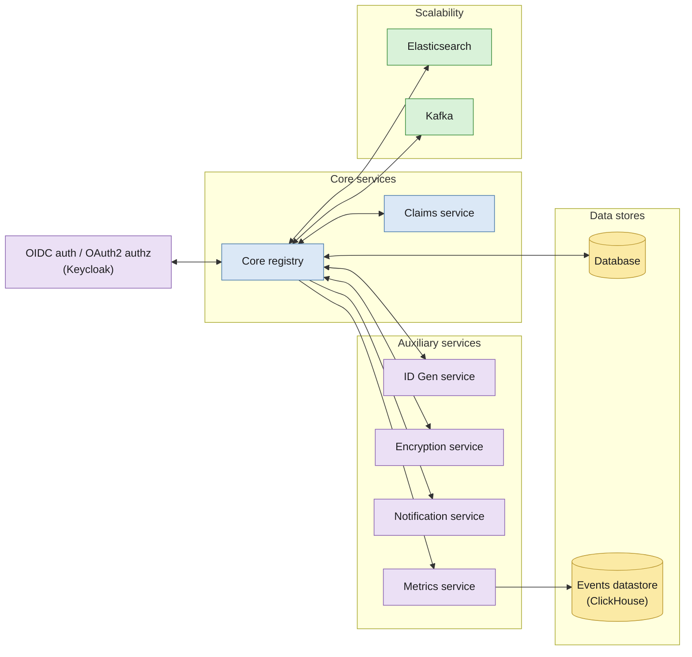

# High-Level architecture

The microservices that make up the Sunbird RC registry, and what each one does.

<i class="rc-swatch core"></i>Core services<i class="rc-swatch aux"></i>Auxiliary services<i class="rc-swatch scale"></i>Scalability<i class="rc-swatch db"></i>Data stores

The microservices built as part of Sunbird RC, and their purpose, are explained below.

## At a glance

<table data-search="false"><thead><tr><th width="200">Service</th><th>When you need it</th></tr></thead><tbody><tr><td><strong>Registry (core)</strong></td><td>Always — the core service</td></tr><tr><td><strong>Claim ms</strong></td><td>If attestation or workflows are required</td></tr><tr><td><strong>Notification ms</strong></td><td>To send SMS or email (invites, OTPs)</td></tr><tr><td><strong>Metrics service + ClickHouse</strong></td><td>To capture and query registry events</td></tr><tr><td><strong>DB</strong></td><td>Always — the main data store</td></tr><tr><td><strong>Elasticsearch</strong></td><td>To enable discovery of public data</td></tr><tr><td><strong>Keycloak</strong></td><td>For authentication and authorization (replaceable)</td></tr><tr><td><strong>Kafka</strong></td><td>For asynchronous entity creation under high load</td></tr><tr><td><strong>Encryption</strong></td><td>To store private fields encrypted</td></tr><tr><td><strong>ID Gen</strong></td><td>To generate formatted IDs for schema fields</td></tr></tbody></table>

## Core service

### Registry (core)

The core service that enables the major functionality of Sunbird RC. It exposes APIs to configure schemas and manage entities and workflows, and can create entities synchronously or asynchronously. The registry supports several database providers:

1. Graph database (Neo4j)
2. Relational databases (PostgreSQL, HSQLDB, H2, MariaDB, MySQL, MSSQLServer)
3. NoSQL databases (Cassandra)

The registry dynamically generates REST APIs for the schemas you create, and applies authentication and authorization to those APIs based on the schema configuration. It also provides a discovery API for searching the public data of a particular schema.

::: info
Elasticsearch needs to be configured with the registry to enable schema discovery.
:::

## Supporting services

### Claim ms

Needs to be enabled if attestation or workflows are required. This service handles all the claims of an attestation.

### Notification ms

Sends SMS or emails to users. The registry uses it to send invite notifications, and Keycloak uses it to send OTP messages. It can be configured with third-party plugins to send notifications.

### Metrics service

Handles all the events emitted by the registry through Kafka and stores them in ClickHouse, though the service can also connect to other databases. It exposes an API that returns all the emitted events.

### Encryption

Stores private fields configured in a schema in encrypted form in the database; they can only be decrypted by the encryption service. Enable it through the appropriate environment variables.

### ID Gen

Generates IDs in a given format for any fields in the schema. Provide the format configuration in the schema configuration, and enable the service through environment variables.

## Infrastructure

### DB

The registry requires a main database to store all data. Any of the database providers listed under [Registry (core)](#registry-core) can be used.

### ClickHouse

An open-source database used to store all the events emitted by the registry.

### Elasticsearch

Stores all public data and enables its discovery.

### Keycloak

Enables authentication and authorization of users on the APIs. It can be replaced by any OpenID Connect identity provider and OAuth2-compliant resource server.

### Kafka

Required to create entities asynchronously. If the system needs to handle high load and high availability, entity creation (with credential generation) can be processed asynchronously using Kafka.

## Video walkthrough

::: warning
This video was recorded on Dec 22 for **v0.0.13**, so some details may differ from the current release.
:::

<iframe src="https://www.youtube-nocookie.com/embed/mZjYgdxu0gU" title="Video recorded on Dec 22. The video is recorded for v0.0.13" allowfullscreen loading="lazy"></iframe>

Video recorded on Dec 22. The video is recorded for v0.0.13

